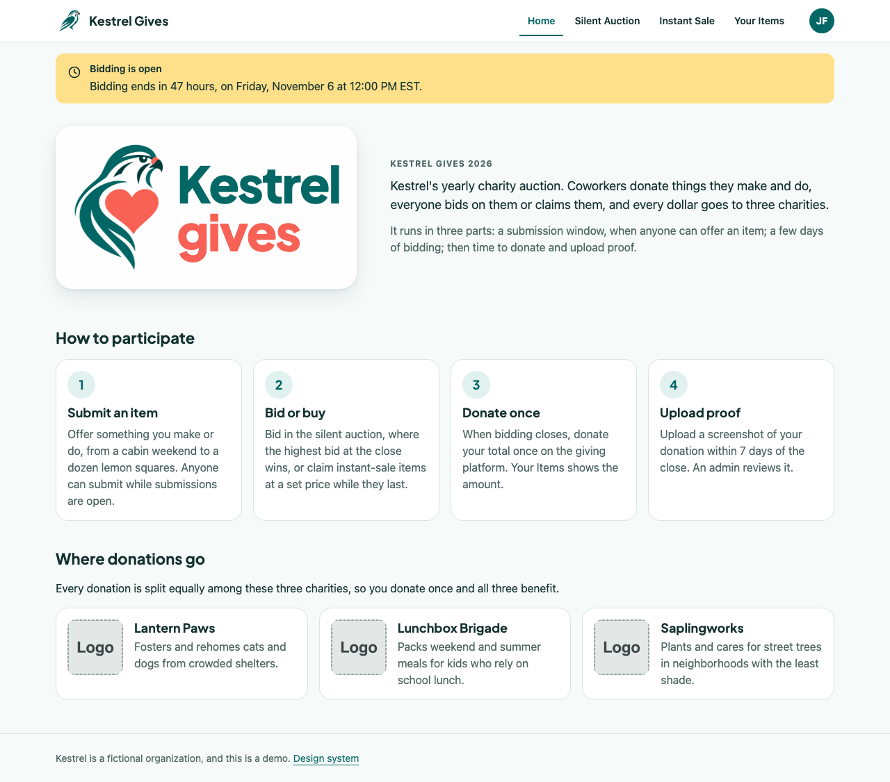
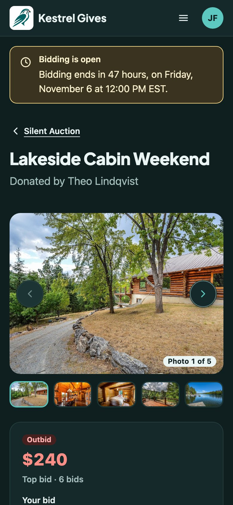
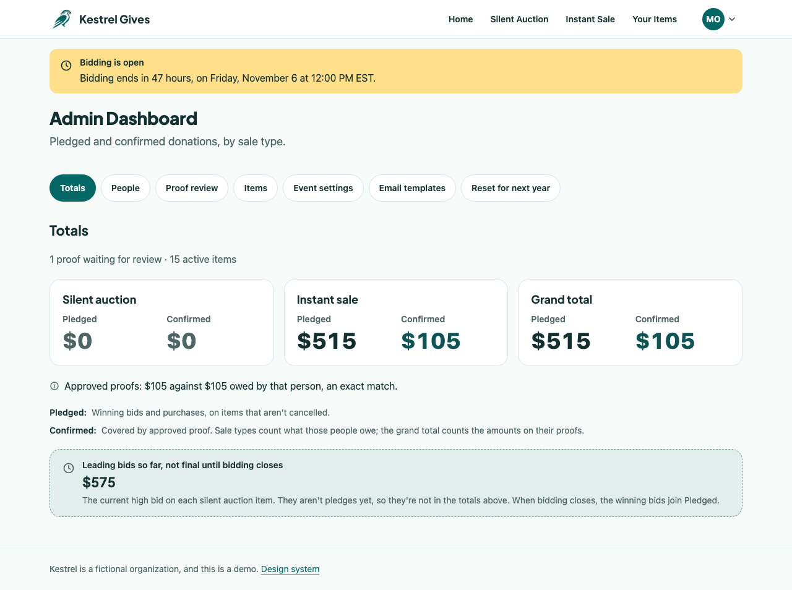
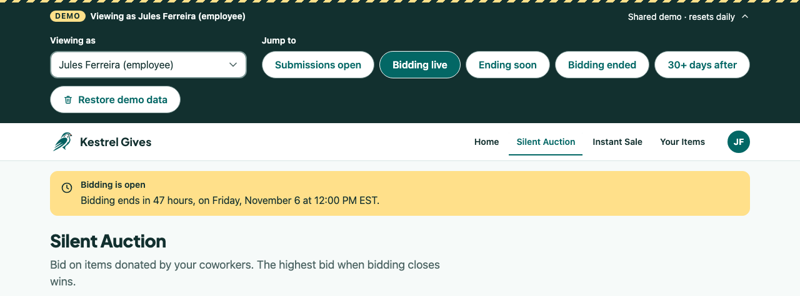

# Kestrel Gives

**Live demo: [kestrel-gives.vercel.app](https://kestrel-gives.vercel.app)**

**New here? [Things to try](https://kestrel-gives.vercel.app/guide):** six short scenarios, each set up with one button, with a line on why each flow works the way it does.

A web app for running a yearly charity auction: silent auction and instant-sale items, bidding, inventory, donation proof, and an admin dashboard. Built as a portfolio case study in designing and building with AI.

Recreated from memory after leaving Netflix. No original code, designs, or data were used.

Kestrel is a fictional organization, and this is a demo. Every person, item, and charity in it is invented.

| | |
|---|---|
|  |  |
|  |  |

The photos in the screenshots are the demo's seed photos, from Pixabay, credited in [`CREDITS.md`](CREDITS.md).

## Take the tour

The demo is shared: everyone sees the same data, and it restores itself every day. The bar across the top is for trying it out, and a welcome dialog on your first visit points the way (**About this demo** in the bar opens it again). [Things to try](https://kestrel-gives.vercel.app/guide) (`/guide`) walks through the main flows; its **Set me up** buttons use these same controls and say first what they change.

- **Viewing as:** be any of the seven seeded people. Jules is an employee; Maya and Theo are admins and see the **Admin Dashboard** in the avatar menu.
- **Event phase:** move the event to another phase: submissions open, bidding live, ending soon, bidding ended, or 30+ days after. It moves the event's dates, never the clock, so the real rules apply. **Submissions open** also clears every bid, purchase and proof, since that phase can't have any, and asks first.
- **Restore demo data:** put everything back as seeded, with bidding live.
- **Reset for next year** (admins, under Admin Dashboard): unlocks 30 days after bidding closes, so jump to "30+ days after" first. It empties the event for next year, and Home then offers Restore demo data.
- Add `?demo=off` to any address to hide the bar.

Things to try: as Jules, bid on the Lakeside Cabin Weekend, buy something from Instant Sale, and look at Your Items. Move the event to "Bidding ended" to see what winners owe, then upload proof. As Maya, review that proof, remove a bid, cancel an item, or edit an email template. The [design system gallery](https://kestrel-gives.vercel.app/design-system/) shows every component in every state.

## How this was built

[Claude Code](https://claude.com/claude-code) wrote the code. The owner wrote [`SPEC.md`](SPEC.md), set the direction, made the logos, and reviewed every stage. The spec is the contract: what to build, and the rules every change follows, such as tokens only, WCAG 2.2 AA in light and dark, and approved dependencies only.

The work ran in seven milestones: design system, data, app shell, browsing and buying, employee flows, admin, and polish and ship. Each was planned first, then built in small stages. Every stage ended at a checkpoint: all eight conformance checks passing (SPEC section 12), screenshots and a Preview deployment for the owner to review, and nothing on the live site until the owner said go.

- [`DECISIONS.md`](DECISIONS.md): every significant decision, the options considered, and why.
- [`BUILD-LOG.md`](BUILD-LOG.md): dated entries for each stage: what was built, what was hard, where the owner stepped in, and how long each milestone took.
- [`DESIGN-SYSTEM.md`](DESIGN-SYSTEM.md): every component, its states and its do's and don'ts, with the [gallery](https://kestrel-gives.vercel.app/design-system/) (source in [`public/design-system/`](public/design-system/)).
- [`CREDITS.md`](CREDITS.md): the heading font and the seed photos.

## Stack

Plain HTML, CSS, and TypeScript, compiled with `tsc` to native ES modules (no framework, no bundler). Vercel hosts the static front end and the TypeScript API functions. Data lives in Neon Postgres (plain SQL, no ORM) and uploads in Vercel Blob.

## Run it locally

Prerequisites: Node 24, and the Vercel CLI installed globally (`npm install -g vercel`), logged in with access to the project.

```sh
npm install
vercel link              # once: connect this folder to the Vercel project
npm start                # http://localhost:3000
```

`npm start` runs `tsc --watch` (front end → `public/js/`), the component CSS build in watch mode (`public/styles/components/*.css` → `public/styles/components.css`, generated and not committed), and `vercel dev` (static files and API functions) together. Ctrl-C stops both. There's no hot reload; refresh the browser after a change.

It's `npm start` rather than `npm run dev` because `vercel dev` refuses to run when `package.json` has a `dev` script that leads back to itself (see DECISIONS #33).

### `.env.local`

Never committed; a pre-commit hook blocks `.env` files and database URLs. It holds:

| Key | What |
|---|---|
| `DATABASE_URL` | Pooled connection string for the Neon **`dev`** branch. Never `main`, which is the live demo. |
| `NEON_DEV_ENDPOINT` | The `dev` branch's endpoint ID (`ep-…`) |
| `NEON_MAIN_ENDPOINT` | The `main` branch's endpoint ID. Database scripts refuse to run against it without `--allow-main`. |
| `VERCEL_OIDC_TOKEN` | Written by the Vercel CLI |

Vercel CLI commands may rewrite .env.local; run npm run db:check afterward.

#### Refreshing `VERCEL_OIDC_TOKEN`

The token lasts about 12 hours. Don't run `vercel env pull .env.local`: the Development environment has no Neon variables, so it would replace the file and drop `DATABASE_URL` and both `NEON_*` keys. Instead, pull into a separate gitignored file, copy only the token across, and delete the pull:

```sh
vercel env pull .env.vercel-pull --environment=development --yes
node -e '
const fs = require("fs");
const token = fs.readFileSync(".env.vercel-pull", "utf8").split("\n").find((l) => l.startsWith("VERCEL_OIDC_TOKEN="));
if (!token) { console.error("No VERCEL_OIDC_TOKEN in the pull; nothing changed."); process.exit(1); }
const lines = fs.readFileSync(".env.local", "utf8").split("\n");
const i = lines.findIndex((l) => l.startsWith("VERCEL_OIDC_TOKEN="));
if (i === -1) lines.push(token); else lines[i] = token;
fs.writeFileSync(".env.local", lines.join("\n"));
console.log("VERCEL_OIDC_TOKEN replaced; nothing else in .env.local changed.");'
rm .env.vercel-pull
npm run db:check
```

None of this prints the token. If the pull fails with `challenge_required`, run `vercel login` in your own terminal and try again.

#### One machine at a time on `dev`

Only one machine runs anything against the Neon `dev` branch at a time: checks, `npm start`, measurements. Tests reseed `dev`, so two machines at once interfere with each other's results and timings.

### Database

```sh
npm run db:check         # confirms DATABASE_URL points at dev; prints endpoint IDs only
npm run db:migrate       # applies new files in migrations/ (numbered SQL, each in a transaction)
npm run db:seed          # loads the demo data; safe to re-run
```

### Uploads

On the deployed site, uploads go to one public Vercel Blob store under a per-environment prefix (`production/`, `preview/`). Locally and in tests they go to `.local-uploads/` (ignored by git). Seed photos never go in git: the deployed site reads them from the same Blob store under `seed/`, and local dev from gitignored copies in `public/seed/` (or the placeholder when those aren't there). To make the local copies, put the Pixabay originals listed in `lib/seed/photos.ts` in `.seed-photos/originals/` and run `npm run seed:photos:process` (macOS, uses `sips`). `npm run seed:photos:upload` puts them in Blob; it needs `BLOB_READ_WRITE_TOKEN` set for that one command (DECISIONS #77).

## Checks

Every change must pass the eight conformance checks in SPEC.md section 12. `npm run check` runs them all, one after the other: the database and browser checks share the `dev` database, so they never run at the same time. That full check is for pushes to `main`, milestone ends, and stages that change the schema, the seed or the demo controls. At other stage checkpoints, `npm run check:quick` runs the fast checks plus the database and browser tests mapped from the files changed against `main` (`scripts/quick-map.ts`), and prints what it ran and why; `--dry-run` prints the plan only (SPEC §12, v1.23).

| Script | Check |
|---|---|
| `npm run check:deps` | `package.json` lists only the packages in SPEC.md's approved table (read from the spec itself) |
| `npm run check:seed-images` | No `.jpg`/`.jpeg`/`.png`/`.webp` tracked under a seed or photo path, except the two placeholders (also run by the pre-commit hook) |
| `npm run check:tokens` | No raw colors or lengths in `public/` or `src/` outside `public/styles/tokens.css` (except the two named breakpoints, inside `@media`/`@container` conditions); type set with `--type-*` roles, not `--text-*` steps; every color token has a light and a dark value |
| `npm run check:types` | `tsc --noEmit` for server and browser code |
| `npm run test:rules` | `node:test` unit tests of the rules in SPEC §7 and the pure code around them |
| `npm run test:db` | `node:test` against real Postgres on the `dev` branch: simultaneous bids and purchases, phases, proofs, admin actions, Restore and Reset. Most suites seed once in a transaction and roll each test back to a savepoint; the simultaneous ones commit and reseed |
| `npm run check:a11y` | axe (WCAG 2.2 AA) on every screen in `tests/e2e/screens.ts`, light and dark, at 390px and 1280px; zero violations allowed |
| `npm run check:reflow` | Every screen at 320px wide: no sideways scrolling and nothing cut off (WCAG 2.2 reflow); scroll regions and ellipsis truncation allowed |
| `npm run check:visual` | Full-page screenshots of every screen as seeded, then of each other phase and the "just reset" state on the screens it changes, light and dark, at 390px and 1280px, with `?demo=off`, saved to `visual-review/` for a person to review. Runs one test at a time, since each sets the shared dev database's phase; each state is set once and shot in all four views side by side. It also runs `demo-jump.spec.ts`, which clears the demo's activity through the demo bar |

The browser checks start `npm start` themselves (or reuse one that's running) and reseed the `dev` database first. One-time setup for them:

```sh
PLAYWRIGHT_BROWSERS_PATH=0 npx playwright install chromium   # installs into node_modules/
```

## Deploy

Pushes to `main` deploy the live demo through Vercel's GitHub integration; other branches get Preview deployments. Production uses the Neon `main` branch; Preview and local work use `dev`.

The production build compiles the front end, checks types, runs the unit tests, and then runs `scripts/deploy-db.ts`. That script applies new migrations and seeds an empty database, under one Postgres lock, and only after confirming it's a production build pointed directly at `main`. A failure stops the deployment going live. A daily Vercel cron (`/api/cron-restore`) restores the demo.

Vercel environment variables (names only): `DATABASE_URL` and `DATABASE_URL_UNPOOLED` (from the Neon integration), `BLOB_READ_WRITE_TOKEN` (from the Blob store), `SEED_PHOTOS_BASE_URL` (where the seed photos live in Blob), and `CRON_SECRET` (so only Vercel's cron can call the restore).
